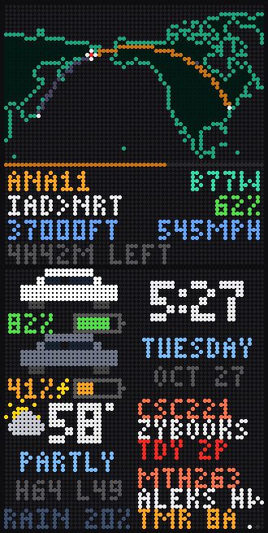

# FlightWall DIY

A Raspberry Pi + two HUB75 LED panels that show the planes flying near your home, plus a personal dashboard.



**Flight panel** (two modes that take turns, set with `top_mode`):
- **Map:** picks the most interesting flight that just left a home airport (IAD/DCA/BWI by default). Long routes, international flights, big or rare jets, and military flights score higher. It then follows the flight live on an auto-zoomed map until it lands. A solid line shows where it's been, a dotted line shows where it's going, and the destination blinks. Stats underneath: callsign, aircraft type, route, altitude, speed, % complete, and time left. Over the ocean, out of receiver range, the plane is moved along its route at its last speed and marked **EST**.
- **Overhead:** the planes right above your house (callsign, type, route, altitude, speed, distance).

**Info panel**, split into four corners:
- Two Teslas (one icon per car color) with battery %, a gauge, and a blinking bolt while charging
- Clock, day, and date
- Weather with conditions, high/low, and rain chance
- Upcoming Canvas assignments, two at a time, red when due within 24 hours. Sorted by due date and ignoring Canvas's "submitted" flag, since zyBooks marks work submitted as soon as you open it.

## Hardware

| Part | Notes |
|---|---|
| Raspberry Pi 4 (any RAM) + USB-C power supply | Power the Pi through **its own** USB-C port |
| 32 GB microSD card | |
| 2× 64×64 RGB LED panel, P3, HUB75 | Each comes with a ribbon and a power cable |
| Seengreat / WatangTech RGB Matrix Adapter Board (Rev 3.9) | Sits on the Pi's 40-pin header |
| 5V 8A power supply, 5.5×2.1 mm barrel | Powers the panels through a screw-terminal adapter |

## Data sources

| What | Service | Account needed |
|---|---|---|
| Live flights | [adsb.fi](https://github.com/adsbfi/opendata) open data | No |
| Routes and aircraft types | [adsbdb](https://www.adsbdb.com) | No |
| Weather | [Open-Meteo](https://open-meteo.com) | No |
| Teslas | [Tessie](https://tessie.com) API token | Yes |
| Assignments | Canvas personal access token | Yes |

## Setup

### 1. Flash the SD card
1. Install **Raspberry Pi Imager**. Choose **Raspberry Pi 4** → **Raspberry Pi OS Lite (64-bit)** (under "Raspberry Pi OS (other)") → your SD card.
2. In the customisation step: hostname `flightwall`, a username and password you'll remember, your Wi-Fi, and turn on **SSH** with password authentication.
3. Write the card and put it in the Pi.

### 2. Hook up the hardware (power off)
1. Press the adapter board onto the Pi's 40 pins, with the board's corner holes lined up over the Pi's corner holes. **A board shifted by one row can short the Pi.**
2. Ribbon: board **HUB75** → panel 1 **IN** (the connector away from the power plug). Second ribbon: panel 1 **OUT** → panel 2 **IN**.
3. Panel power cable plugs → each panel's +5V/GND socket. Clamp the forks into the screw-terminal adapter (red → **+**, black → **−**) and tighten hard. A loose clamp makes blue and green drop out and leaves only red.
4. 5V 8A supply → the screw-terminal adapter. Pi power supply → **the Pi's** USB-C port, not the adapter board's.

### 3. Install
Wait 2 minutes after powering on, then from your computer:

```bash
ssh <username>@flightwall.local
```

On the Pi:

```bash
sudo apt install -y git
git clone https://github.com/xDave12x/FlightWall.git
cd flightwall
bash install.sh
sudo reboot
```

### 4. Test, then add your keys
```bash
cd ~/flightwall
./run.sh --mock        # sample data on the real panels; Ctrl+C to stop
```

When the panels look right, edit `config.toml` (`nano config.toml`) with your home location, Tessie token, and Canvas tokens, then run `./run.sh` for live data.

### 5. Start on boot
```bash
sudo systemctl enable --now flightwall
```
Check it with `sudo systemctl status flightwall`, and stop it with `sudo systemctl stop flightwall`.

## Display settings (`config.toml`)

| Setting | What it does |
|---|---|
| `layout` | `"side"` = panels side by side, `"stacked"` = one above the other |
| `rotate` | `180` flips everything if the panels are mounted upside down |
| `panels` | `1` makes a single panel alternate between the flight and info screens |
| `brightness` | 1–100. Start at 60, since two panels at full white can exceed 8A |
| `gpio_slowdown` | 4 for a Pi 4. Raise it for flicker or sparkles |
| `hardware_mapping` | `"regular"` for the Seengreat board. Try `"adafruit-hat"` for an Adafruit board |
| `panel_type`, `pwm_lsb_nanoseconds`, … | Optional tuning for panels with unusual driver chips |

## Troubleshooting

| Symptom | Likely cause |
|---|---|
| Random red dots on both panels | The program isn't running (nothing is driving the panels) |
| Only red works, or blue/green drop out under load | Loose panel power. Re-clamp the screw terminal |
| A color is stuck on across one half of every panel | A data line from the Pi or adapter board. Check the pins and board seating, then swap the board |
| Bottom half of each panel copies the top half | The adapter isn't sending the "E" address line 64×64 panels need |
| `ssh` says "Connection reset" | The Pi is still booting. Wait 30 seconds |
| Pi's green light never flickers | SD card not seated or corrupted. Reseat it, or re-flash |

## Preview without hardware
```bash
pip install pillow requests
python3 main.py --mock --preview preview.png --gif preview.gif
```

## Files
- `main.py`: entry point and main loop
- `render.py`: draws both panels (pixel font, icons, layouts)
- `maps.py`: world map from `land_mask.bin`, great-circle math, auto-zoom
- `sources.py`: background data fetchers (flights, weather, Teslas, Canvas)
- `display.py`: LED output and the PNG/GIF preview renderer
- `install.sh` / `run.sh`: Pi setup and launcher
